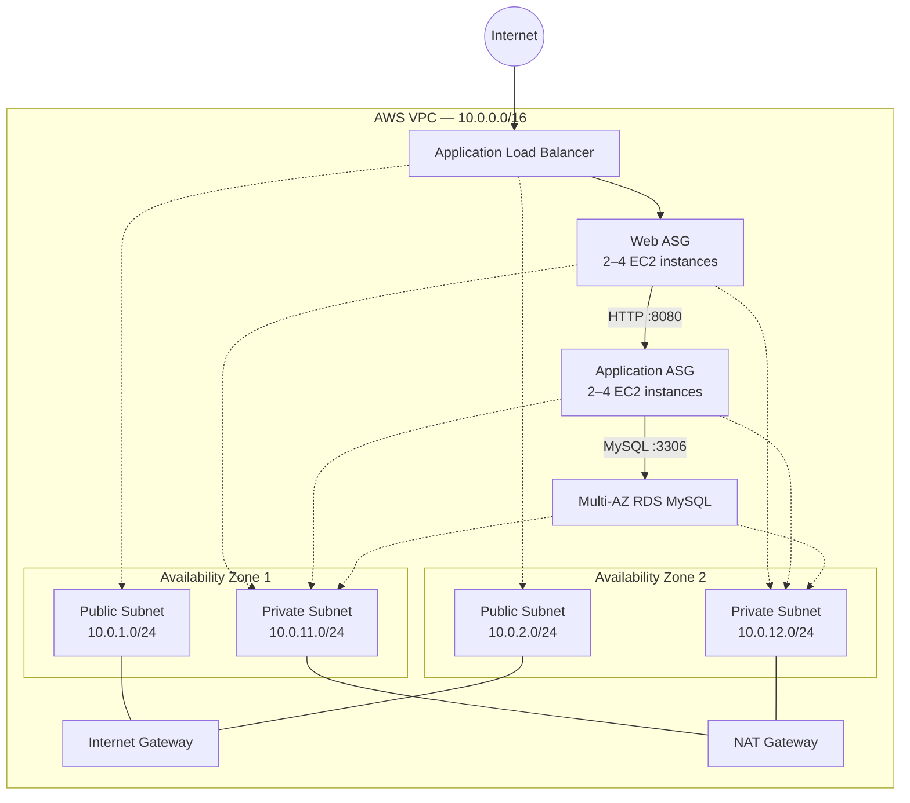

# AWS Three-Tier Architecture with Terraform

[](https://www.terraform.io/)
[](https://aws.amazon.com/)
[](LICENSE)

A production-oriented Infrastructure as Code (IaC) project that deploys a highly available, three-tier application architecture on AWS using Terraform modules.

## Architecture



### Components

| Tier | AWS resources | Purpose |
|---|---|---|
| Network | VPC, public/private subnets, Internet Gateway, NAT Gateway | Isolated network and controlled internet access |
| Web | Application Load Balancer, launch template, Auto Scaling Group | Public HTTP entry point and scalable web tier |
| Application | Launch template and Auto Scaling Group | Private application tier on port `8080` |
| Database | RDS MySQL, DB subnet group | Private, Multi-AZ database tier |

Security groups enforce least-privilege traffic:

- Internet to load balancer: HTTP port `80`
- Load balancer to web instances: HTTP port `80`
- Web instances to application instances: port `8080`
- Application instances to RDS: MySQL port `3306`

## Repository Structure

```text
.
├── backend.tf                 # AWS provider and S3 remote state backend
├── main.tf                    # Root module composition
├── variables.tf               # Root input variables
├── outputs.tf                 # Root outputs
├── terraform.tfvars.example   # Safe example variable values
├── modules/
│   ├── network/               # VPC, subnets, routing, NAT, security groups
│   ├── web/                   # Public ALB and web Auto Scaling Group
│   ├── app/                   # Private application Auto Scaling Group
│   └── db/                    # RDS MySQL instance and subnet group
```

## Prerequisites

- [Terraform](https://developer.hashicorp.com/terraform/install) `>= 1.0`
- [AWS CLI](https://docs.aws.amazon.com/cli/latest/userguide/getting-started-install.html)
- An AWS account with permission to create VPC, EC2, ELB, Auto Scaling, IAM-independent networking, and RDS resources
- Valid EC2 AMI IDs for `ap-south-1`
- An existing S3 bucket for Terraform remote state

Configure AWS credentials using one of the supported AWS methods:

```bash
aws configure
```

Verify access:

```bash
aws sts get-caller-identity
```

## Remote State

The backend is configured in `backend.tf`:

```hcl
bucket = "kunal1625-123"
key    = "3tier/prod/terraform.tfstate"
region = "ap-south-1"
```

Update the bucket name and key before deployment if they do not belong to your AWS account. The S3 bucket must exist before running `terraform init`.

## Deployment

1. Copy the example variables file:

   ```bash
   cp terraform.tfvars.example terraform.tfvars
   ```

   On Windows PowerShell:

   ```powershell
   Copy-Item terraform.tfvars.example terraform.tfvars
   ```

2. Update `terraform.tfvars` with values for your AWS account and region. Replace the example database password with a strong secret.

3. Initialize Terraform and download providers/modules:

   ```bash
   terraform init
   ```

4. Review the deployment plan:

   ```bash
   terraform plan
   ```

5. Create the infrastructure:

   ```bash
   terraform apply
   ```

6. Open the load balancer DNS returned by `terraform output web_alb_dns`.

> Do not commit `terraform.tfvars`, state files, or database credentials to source control.

## Input Variables

| Variable | Description | Default |
|---|---|---|
| `aws_region` | AWS deployment region | `ap-south-1` |
| `vpc_cidr` | VPC CIDR block | `10.0.0.0/16` |
| `public_subnets` | CIDR blocks for public subnets | Required |
| `private_subnets` | CIDR blocks for private subnets | Required |
| `azs` | Availability zones | Required |
| `web_ami_id` | AMI ID for web instances | Required |
| `app_ami_id` | AMI ID for application instances | Required |
| `web_instance_type` | Web EC2 instance type | `t3.micro` |
| `app_instance_type` | Application EC2 instance type | `t3.micro` |
| `load_balancer_type` | Load balancer type | `application` |
| `db_username` | RDS master username | Required |
| `db_password` | RDS master password; marked sensitive | Required |
| `db_name` | Initial database name | `production` |
| `db_instance_class` | RDS instance class | `db.t3.micro` |
| `storage_type` | RDS storage type | `gp2` |
| `engine` | RDS database engine | `mysql` |
| `engine_version` | RDS database engine version | `8.0.43` |
| `skip_final_snapshot` | Skip the RDS final snapshot during destroy | `true` |
| `publicly_accessible` | Assign RDS a public endpoint | `false` |
| `deletion_protection` | Prevent RDS deletion | `false` |

The web and application Auto Scaling Groups use a minimum of `2`, desired capacity of `2`, and maximum of `4` instances.

## Outputs

| Output | Description |
|---|---|
| `web_alb_dns` | DNS name of the public Application Load Balancer |
| `db_endpoint` | RDS database connection endpoint |

Display outputs after deployment:

```bash
terraform output
terraform output web_alb_dns
terraform output db_endpoint
```

## Validation and Formatting

Before committing changes:

```bash
terraform fmt -recursive
terraform validate
terraform plan
```

## Destroy

Preview destroyed resources and remove the infrastructure:

```bash
terraform plan -destroy
terraform destroy
```

If `deletion_protection` is enabled, disable it before destroying the database. If `skip_final_snapshot` is `false`, Terraform will create a final snapshot during deletion.

## Cost and Operational Notes

This deployment creates billable resources, including NAT Gateway, Application Load Balancer, EC2 instances, and a Multi-AZ RDS instance. A NAT Gateway is the only network route provided for private subnet outbound access.

For a production environment, consider adding:

- HTTPS with an ACM certificate
- Route 53 DNS
- AWS Secrets Manager for database credentials
- CloudWatch alarms and log collection
- RDS automated maintenance and backup policies
- Remote-state locking with DynamoDB
- TLS or HTTP health-check hardening
- Private application endpoints and restricted administration access

## Troubleshooting

**Backend bucket does not exist**

Create the S3 bucket or change `bucket` in `backend.tf`, then run `terraform init -reconfigure`.

**AMI ID is not found**

Replace `web_ami_id` and `app_ami_id` with AMI IDs that exist in the selected region.

**Terraform cannot select AWS credentials**

Run `aws configure` or provide credentials through environment variables or an AWS IAM role.

**ALB health checks fail**

Verify that instances serve HTTP on port `80` and that the web launch template or AMI starts the web server.
